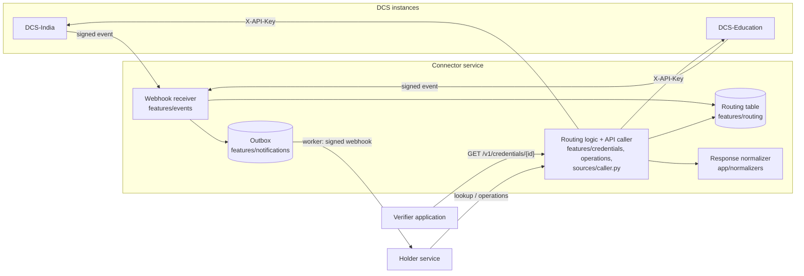

# everycred-connector-service — architecture

> Last updated: 2026-10-28

The connector sits between EveryCRED DCS instances (one per region or
sector, such as DCS-India and DCS-Education) and the applications that
need their credentials: verifier applications and the holder (wallet)
service. It knows **where** each credential lives, never **what** it
contains.

## Flows

1. **Credential issued.** The DCS posts `credential.issued`. The
   webhook receiver verifies the signature, records the delivery id,
   routes the credential id to the source, links the holder (by a keyed
   hash of the email) to the source, and queues a notification. The
   worker forwards it to the holder service, which notifies the wallet.
2. **Verifier query.** A verifier calls `GET /v1/credentials/{id}`. The
   routing table names the source; the API caller fetches the
   credential; the normalizer returns the standard
   `NormalizedCredential`.
3. **Holder fetch.** The holder service asks for all of a holder's
   credentials; the connector fetches them from every source
   concurrently and stores nothing.
4. **Holder operations.** Request lists, submissions, workflow steps,
   KYC and DigiLocker calls go through `POST /v1/holders/operations`,
   which forwards a named operation to the right DCS.
5. **Holder onboarding.** An issuer invite in a DCS posts
   `holder.invited`; the connector links the holder and forwards it.
   When the holder signs up, the holder service runs the
   `holder.registered` operation on every linked DCS, which marks the
   holder registered and the invite accepted.

## Features

| Package | Responsibility | Doc |
|---|---|---|
| `features/sources` | DCS registry and the API caller | [sources](features/sources.md) |
| `features/clients` | Verifier / holder service API keys | [clients](features/clients.md) |
| `features/events` | Webhook receiver | [events](features/events.md) |
| `features/routing` | Routing table | [routing](features/routing.md) |
| `features/credentials` | Credential lookups | [credentials](features/credentials.md) |
| `features/operations` | Holder operations | [operations](features/operations.md) |
| `features/notifications` | Outbox to the holder service | [notifications](features/notifications.md) |
| `features/health` | Probes | [health](features/health.md) |
| `normalizers` | Source formats | [normalizers](features/normalizers.md) |

Core modules are documented in [`docs/core/`](core/). What a DCS must
implement is in [`dcs_contract.md`](dcs_contract.md). Running one
connector for DCS instances in several regions is described in
[`multi_region_deployment.md`](multi_region_deployment.md).

## Adding code

- New features go in `app/features/<name>/` and are mounted in
  `app/api/router.py`; import new models in `migrations/env.py` and
  `tests/conftest.py`.
- A new source format is a module in `app/normalizers/` decorated with
  `@register_normalizer(name, credential_path=...)` and imported in
  `app/normalizers/__init__.py`.
- A new holder operation is one entry in
  `app/features/operations/catalog.py` plus the matching DCS route.
