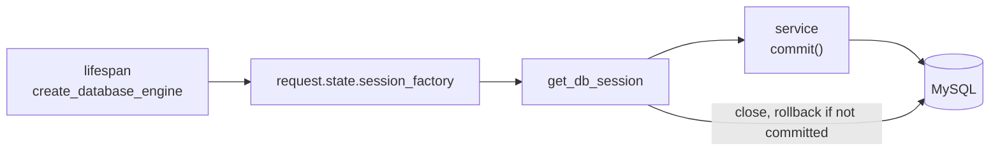

# `app/core/database.py`

> Last updated: 2026-10-21

## Purpose

Creates the async SQLAlchemy engine and session factory, the declarative
`Base` for all ORM models, and the `DbSession` dependency that gives each
request its own session. Nothing here connects to the database at import
time. Tests and tooling can import models without a running MySQL.

Used by every feature with a database table, the health check, the
application lifespan in `app/main.py`, and the worker in `app/worker.py`.

## Public API

### `Base`

Declarative base for every ORM model. Its `metadata` uses
`NAMING_CONVENTION`, so constraint names are deterministic and Alembic
autogenerate can name them.

```python
from app.core.database import Base


class Widget(Base):
    __tablename__ = "widgets"
    ...
```

### `create_database_engine(settings: Settings) -> AsyncEngine`

Builds the engine from `DATABASE_URL` and the pool settings. Call it once
per process. `app/main.py` calls it in the lifespan; `app/worker.py`
calls it in `run_forever`.

Pool options:

- `pool_pre_ping=True` checks each connection before use. This drops
  connections that MySQL closed while they were idle.
- `pool_recycle` comes from `DATABASE_POOL_RECYCLE_SECONDS`.

### `create_session_factory(engine: AsyncEngine) -> async_sessionmaker[AsyncSession]`

Returns a factory bound to `engine`, with `expire_on_commit=False`. After
a commit, loaded attributes stay readable, so async code does not trigger
implicit lazy loads.

### `ping_database(engine: AsyncEngine) -> None`

Runs `SELECT 1` on a new connection. Raises the driver error if the
database cannot be reached. Used by the readiness probe.

### `get_db_engine(request: Request) -> AsyncEngine`

Returns `request.state.db_engine`, which the lifespan sets.

### `get_db_session(request: Request) -> AsyncIterator[AsyncSession]`

Yields one session for the request and closes it afterwards. Closing
rolls back anything the service did not commit.

```python
from app.core.database import DbSession


async def handler(session: DbSession) -> None: ...
```

### `DbEngine` and `DbSession`

`Annotated` aliases for the two dependencies above.

## How it works

1. **Startup** — the lifespan in `app/main.py` calls
   `create_database_engine` and `create_session_factory`, and stores both
   in the lifespan state. Starlette copies that state onto
   `request.state` for every request.
2. **Per request** — `get_db_session` opens a session from the factory
   and yields it. The feature's service runs its work and calls
   `await session.commit()` itself.
3. **Teardown** — when the request ends, `async with` closes the
   session. Any uncommitted change is rolled back.
4. **Shutdown** — the lifespan calls `engine.dispose()`.

Services own the transaction boundary. The dependency never commits, so
a commit cannot happen by accident in a route that only reads.



## Configuration

| Setting / env var | Default | Effect |
|---|---|---|
| `DATABASE_URL` | (required) | Async SQLAlchemy URL. Use `mysql+aiomysql://` |
| `DATABASE_POOL_SIZE` | `5` | Persistent connections in the pool |
| `DATABASE_MAX_OVERFLOW` | `10` | Extra connections above the pool size |
| `DATABASE_ECHO` | `false` | Logs SQL statements |
| `DATABASE_POOL_RECYCLE_SECONDS` | `1800` | Connection age limit before it is replaced |

## Failure modes

| Situation | Behaviour | Logged as |
|---|---|---|
| Database unreachable during a request | The driver error propagates. `RequestContextMiddleware` returns 500 `internal_error` | `ERROR` with traceback |
| Database unreachable during readiness | `ping_database` raises. `HealthService` returns `unavailable` and the probe returns 503 | `ERROR` with traceback |
| Service raises before `commit()` | Session closes, changes roll back | Nothing (handled by the service's exception) |

## Changing this module

- Do not create engines or session factories anywhere else. Use
  `request.state` in the app and `create_database_engine` in the worker.
- Do not add an automatic commit to `get_db_session`. Services commit
  when their work succeeds, and a failure must leave nothing behind.
- Keep the naming convention. Migrations in `migrations/versions/` depend
  on the generated constraint names.
- The engine is driver-agnostic, but the project targets MySQL
  (`aiomysql`). Models must avoid MySQL-only SQL. Tests use in-memory
  SQLite with `StaticPool` (see `tests/conftest.py`).

## Tests

No dedicated module. The database is replaced in tests by overriding
`get_db_session` in `tests/conftest.py`. Readiness behaviour is covered
by `tests/features/health/test_router.py`.
