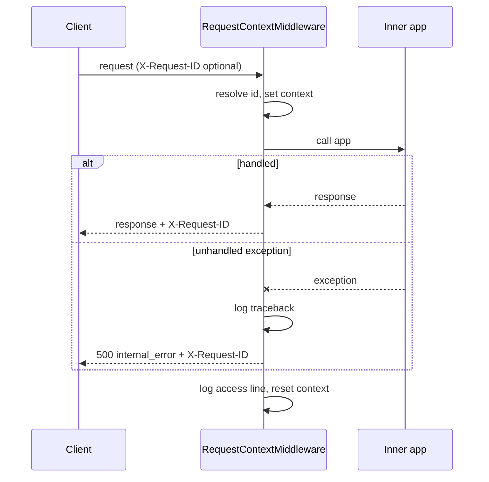

# `app/core/middleware.py`

> Last updated: 2026-10-21

## Purpose

`RequestContextMiddleware` gives every HTTP request an id, logs one line
when it finishes, and turns unexpected exceptions into a 500 response
with the standard error envelope. It is the outermost middleware, so the
request id is set before any other code runs and is still available when
an error is logged.

It is written as plain ASGI. Starlette's `BaseHTTPMiddleware` is not
used because it buffers responses and does not propagate context
variables reliably.

## Public API

### `class RequestContextMiddleware`

`RequestContextMiddleware(app: ASGIApp)`. Registered in `create_app()`
with `app.add_middleware(RequestContextMiddleware)`.

For each `http` scope it:

1. Reads `X-Request-ID`. Uses the value if it matches
   `^[A-Za-z0-9._-]{1,128}$`. Otherwise generates `uuid4().hex`. Anything
   else is replaced, so a caller cannot inject arbitrary text into logs.
2. Sets `request_id_context` for the duration of the request.
3. Adds `X-Request-ID` to the response start message.
4. On an unhandled exception, logs the traceback and, if no response has
   started, sends a 500 `internal_error` envelope.
5. Logs `METHOD path -> status in N ms` at `INFO`, whatever the outcome.

Non-HTTP scopes (`lifespan`, `websocket`) are passed through unchanged.

## How it works

1. **Id** — `_resolve_request_id` validates the incoming header with
   `_VALID_REQUEST_ID`.
2. **Context** — the id is stored with `request_id_context.set`. The
   token is reset in `finally`.
3. **Header** — `send_with_request_id` wraps `send`. It records the
   status code from `http.response.start` and appends the header.
4. **Crash path** — if the inner app raises, the middleware logs with
   `logger.exception`. If the response has not started, it sends a 500
   through `build_error_body`. If it has started, it re-raises, because
   the headers are already on the wire and the server must close the
   connection.
5. **Access line** — written in `finally`, so it appears for crashes too.
   Logged fields are method and path. The query string is not logged.

The request id is a context variable, so tasks created with
`asyncio.gather` inside a request inherit it. This is how the holder
lookups log against the caller's id.

## Configuration

No settings. Behaviour depends on `LOG_LEVEL` for whether the access
line is printed.

## Failure modes

| Situation | Behaviour | Logged as |
|---|---|---|
| Unhandled exception, response not started | 500 `internal_error`, "An unexpected error occurred." | `ERROR` with traceback |
| Unhandled exception, response already started | Re-raised. Connection closed by the server | `ERROR` with traceback |
| Invalid `X-Request-ID` | Replaced with a generated id | Nothing |
| Every request | One access line | `INFO` |

## Changing this module

- Keep it outermost. `app/main.py` adds it after CORS, so it wraps
  CORS preflight responses too.
- Do not log the query string or headers. The holder lookup puts the
  email in the body for this reason.
- Do not replace this with `BaseHTTPMiddleware`.
- The id pattern here is narrower than `IDENTIFIER_PATTERN` (no `:`).
  Keep the two separate. This one is for log correlation, not routing.

## Tests

No dedicated module. Request id echo and 500 handling are not asserted
by a named test in the current suite. Not yet covered: a test that sends an
invalid `X-Request-ID` and checks the response carries a generated id.
