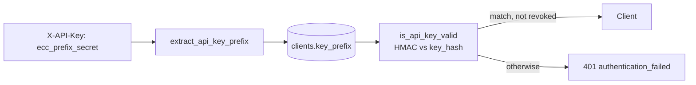

# `app/core/security.py`

> Last updated: 2026-10-21

## Purpose

Authentication for the two kinds of API callers, and the helpers that
create and check client API keys.

- **Operators** send the single `ADMIN_API_KEY` as `X-Admin-Key`. They
  manage sources and clients. The check is `require_admin`, applied by
  `AdminOnly`.
- **Clients** (verifiers and the holder service) send an `X-API-Key`
  issued by an operator. The check is in the clients feature:
  `get_current_client` in `app/features/clients/dependencies.py`, which
  calls `ClientService.authenticate`. This module supplies the key
  format and hashing it relies on.

## Public API

### `require_admin(settings, admin_key) -> None`

FastAPI dependency. Reads `X-Admin-Key` and compares it with
`ADMIN_API_KEY` using `hmac.compare_digest`.

Raises `AuthenticationError` (401, `authentication_failed`) when the
header is missing or wrong.

### `AdminOnly`

`Depends(require_admin)`. Applied to whole routers:

```python
from fastapi import APIRouter

from app.core.security import AdminOnly

router = APIRouter(prefix="/sources", dependencies=[AdminOnly])
```

### `generate_api_key(settings: Settings) -> GeneratedApiKey`

Creates a client key:

- `prefix = secrets.token_hex(6)`: 12 hex characters.
- `secret = secrets.token_urlsafe(32)`: 43 characters.
- `plaintext = f"ecc_{prefix}_{secret}"`.
- `key_hash = hash_api_key(plaintext, settings)`.

Example shape: `ecc_3f9a1c07b2de_<43 URL-safe characters>`.

### `class GeneratedApiKey`

Frozen dataclass with `plaintext`, `prefix`, and `key_hash`. The
plaintext is returned to the operator once and never stored.

### `hash_api_key(api_key: str, settings: Settings) -> str`

Returns the hex HMAC-SHA256 of the key, keyed with `API_KEY_HASH_SECRET`.

### `is_api_key_valid(api_key: str, stored_hash: str, settings: Settings) -> bool`

Hashes `api_key` and compares it with `stored_hash` using
`hmac.compare_digest`.

### `extract_api_key_prefix(api_key: str) -> str | None`

Splits the key on `_` into at most three parts and returns the prefix
when the scheme is `ecc`, the prefix is 12 characters, and the secret is
not empty. Returns `None` otherwise. The secret may contain underscores,
so the split limit is 2.

### Constants

| Name | Value | Meaning |
|---|---|---|
| `API_KEY_SCHEME` | `"ecc"` | Leading label |
| `PREFIX_LENGTH` | `12` | Hex characters in the lookup prefix |

```python
from app.core.security import generate_api_key

key = generate_api_key(settings)
# Store key.prefix and key.key_hash. Return key.plaintext once.
```

## How it works

Client key lifecycle:

1. **Issue** — `ClientService.create_client` calls `generate_api_key`.
   It stores `key_prefix` and `key_hash` on the `clients` row. The
   plaintext goes into the response, once.
2. **Present** — the client sends `X-API-Key`.
3. **Look up** — `extract_api_key_prefix` gets the prefix, and
   `ClientRepository.get_by_key_prefix` finds the row. The prefix is
   unique, so the lookup returns at most one row.
4. **Verify** — `is_api_key_valid` compares the HMAC of the presented key
   with `key_hash`. Revocation is checked by `client.is_revoked`.
5. **Reject** — every failure path, including unknown prefix, wrong
   secret, and revoked client, returns the same 401 message, so a caller
   cannot tell which check failed.

Why the prefix is stored in clear: it allows a lookup by an indexed
column instead of a scan. The prefix alone cannot authenticate a
request. Authentication needs the full key, which is verified against an
HMAC keyed with a server-side secret. A leaked database therefore does
not reveal usable keys.



## Configuration

| Setting / env var | Default | Effect |
|---|---|---|
| `ADMIN_API_KEY` | (required) | Operator key. At least 32 characters |
| `API_KEY_HASH_SECRET` | (required) | HMAC key for client key hashes. At least 32 characters. Changing it invalidates every issued key |

Generate values with:

```bash
python -c "import secrets; print(secrets.token_urlsafe(48))"
```

## Failure modes

| Situation | Behaviour | Logged as |
|---|---|---|
| `X-Admin-Key` missing or wrong | 401 `authentication_failed`, message "A valid X-Admin-Key header is required." | `INFO` (via `handle_app_error`) |
| `X-API-Key` malformed, unknown, wrong, or revoked | 401 `authentication_failed`, message "A valid X-API-Key header is required." | `INFO` |

The 401 response for the admin key includes `WWW-Authenticate: Bearer`,
inherited from `AuthenticationError`. The header does not describe the
scheme in use, but it is harmless.

## Changing this module

- Use `hmac.compare_digest` for every secret comparison.
- Give every `APIKeyHeader` its own `scheme_name` (`AdminKey`,
  `ClientKey`). Without one, they all default to `APIKeyHeader`,
  overwrite each other in the OpenAPI schema, and Swagger's
  **Authorize** dialog sends the key under the wrong header.
- Use `secrets` for anything random. Do not use `random`.
- Do not add a key lookup by full key. The prefix is the only indexed
  lookup.
- Changing `API_KEY_HASH_SECRET` or the key format invalidates all
  client keys. Reissue every client before rotating.
- Changes here affect every route that uses `AdminOnly` or
  `CurrentClient`. Read `app/features/clients/service.py` before editing.

## Tests

`tests/features/clients/test_clients.py` covers key issue
(`test_create_client_returns_key_once`), an unknown key
(`test_unknown_api_key_is_rejected`), a revoked client
(`test_revoked_client_cannot_call_the_api`), and the holder-only check
(`test_verifier_cannot_use_holder_endpoints`).
`tests/features/sources/test_sources.py` covers the admin key
(`test_create_source_requires_admin_key`).

`tests/core/test_security_and_encryption.py` covers key generation,
hash verification, and malformed keys (wrong scheme, short prefix,
empty secret).
