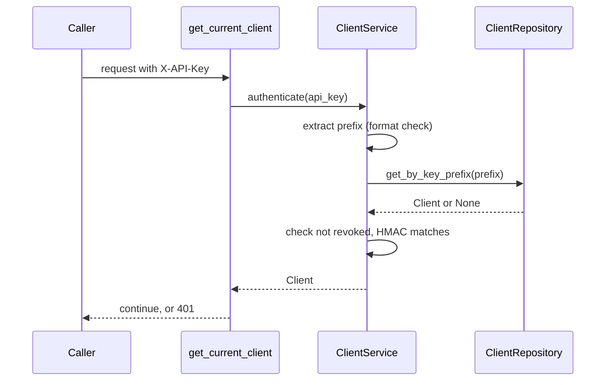

# Clients

> Package: `app/features/clients/`
> Last updated: 2026-10-21

## Overview

A client is an application that calls the connector's API. There are two
kinds:

- `verifier`: a verifier application. It may look up one credential by id.
- `holder_service`: the holder (wallet) service. It may also look up a
  holder's credentials and run holder operations.

Operators register clients and receive an API key once. The connector
keeps only a prefix and an HMAC of the key. Operators can revoke a client,
after which its key is rejected at once.

## Endpoints

| Method | Path | Summary | Auth / permission |
|---|---|---|---|
| POST | `/v1/clients` | Register a client application | `X-Admin-Key` |
| GET | `/v1/clients` | List client applications | `X-Admin-Key` |
| POST | `/v1/clients/{client_id}/revoke` | Revoke a client's API key | `X-Admin-Key` |

### `POST /v1/clients`

Request:

```json
{
  "name": "Holder service",
  "kind": "holder_service"
}
```

| Field | Rules |
|---|---|
| `name` | 1 to 150 characters |
| `kind` | `verifier` or `holder_service` |

Response `201 Created`. `api_key` is present only here:

```json
{
  "id": "00000000-0000-0000-0000-000000000000",
  "name": "Holder service",
  "kind": "holder_service",
  "key_prefix": "3f9a1c07b2de",
  "revoked_at": null,
  "created_at": "2026-10-21T10:00:00Z",
  "api_key": "ecc_3f9a1c07b2de_<43 characters>"
}
```

Errors: 401 `authentication_failed`, 422 `validation_error`.

### `GET /v1/clients`

Query: `limit` (1 to 100, default 20), `offset` (default 0). Newest first.
Returns `Page[ClientResponse]`. Keys are not included.

### `POST /v1/clients/{client_id}/revoke`

Sets `revoked_at` and returns the client. Revoking a client that is
already revoked keeps the first timestamp and succeeds.

Errors: 401 `authentication_failed`, 404 `client_not_found`, 422 when
`client_id` is not a UUID.

```bash
curl -X POST https://connector.example.com/v1/clients \
  -H "X-Admin-Key: <your-admin-key>" \
  -H "Content-Type: application/json" \
  -d '{"name": "Verifier portal", "kind": "verifier"}'
```

Callers then send the returned key as `X-API-Key`:

```bash
curl https://connector.example.com/v1/credentials/<credential-id> \
  -H "X-API-Key: <your-api-key>"
```

## Flow



Permission layers used by other features:

- `CurrentClient` (`app/features/clients/dependencies.py`): any active
  client.
- `CurrentHolderService`: active clients with `kind == holder_service`.
  A verifier gets 403 `permission_denied`.

`AdminOnly` (in `app/core/security.py`) protects the operator routes.

## Data model

Table `clients` (`Client` model):

| Column | Type | Notes |
|---|---|---|
| `id` | UUID | Primary key |
| `name` | string(150) | |
| `kind` | enum, stored as text, max 30 | `verifier` or `holder_service` |
| `key_prefix` | string(12) | Unique, indexed. Lookup value |
| `key_hash` | string(64) | Hex HMAC-SHA256 of the full key |
| `revoked_at` | UTC datetime, nullable | Set on revoke |
| `created_at`, `updated_at` | UTC datetime | |

## Configuration

| Env var | Default | Purpose |
|---|---|---|
| `API_KEY_HASH_SECRET` | (required) | HMAC key for `key_hash`. Changing it invalidates every key |
| `ADMIN_API_KEY` | (required) | Protects the operator routes |

## Design decisions

- **Hash, not encrypt, client keys.** The connector never needs to send a
  client key anywhere, so a one-way hash is enough.
- **One message for every authentication failure.** Unknown prefix, wrong
  key, and revoked client all return the same 401 text. This stops a caller
  from probing which prefixes exist.
- **Revoke instead of delete.** Keeps the row for audit and keeps the
  prefix reserved.
- **Kind is checked in a dependency, not in each service.** Holder-only
  routes declare `CurrentHolderService` and nothing more.

## Known limitations

- A lost key cannot be recovered. Register a new client and revoke the old
  one.
- There is no key rotation endpoint. A new key means a new client.
- Revocation takes effect on the next request. There is no cache to flush.

## Testing

- API tests: `tests/features/clients/test_clients.py`
  (`test_create_client_returns_key_once`,
  `test_unknown_api_key_is_rejected`,
  `test_revoked_client_cannot_call_the_api`,
  `test_verifier_cannot_use_holder_endpoints`).
- The key format and hashing are in [security](../core/security.md).
- Manual check: the two `curl` examples above, with placeholder keys.
