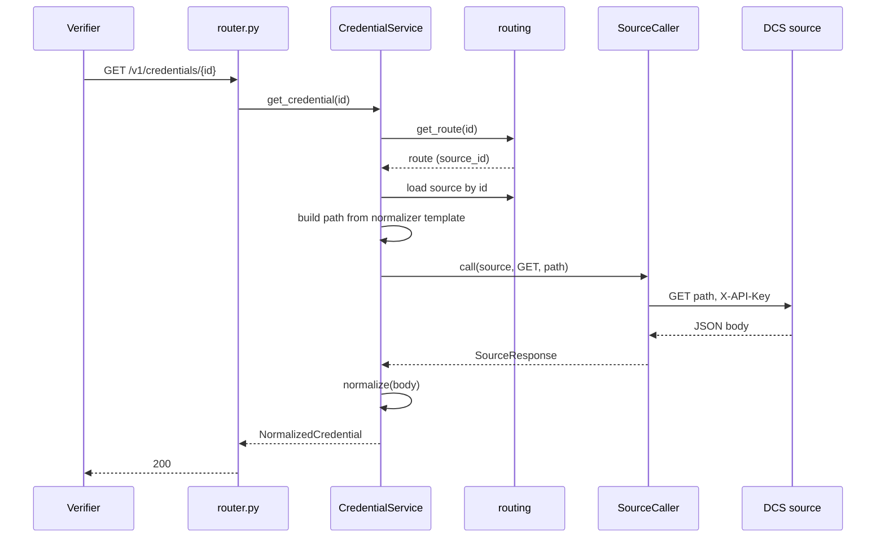

# Credentials

> Package: `app/features/credentials/`
> Last updated: 2026-10-21

## Overview

The credential lookup path. A verifier asks for a credential by id, or the
holder service asks for one holder's credentials. The connector finds the
source in the routing table, fetches the credential from that DCS, and
returns it in the standard `NormalizedCredential` format. Nothing fetched
is stored.

## Endpoints

| Method | Path | Summary | Auth / permission |
|---|---|---|---|
| GET | `/v1/credentials/{credential_id}` | Get a credential by id | Any active client (`X-API-Key`) |
| POST | `/v1/holders/credentials/lookup` | List a holder's credentials | Holder service (`X-API-Key`) |
| POST | `/v1/holders/credentials/get` | Get one of a holder's credentials | Holder service (`X-API-Key`) |
| POST | `/v1/credentials/{credential_id}/verification-analytics` | Record a verification of a credential | Any active client (`X-API-Key`) |

`credential_id` must match `^[A-Za-z0-9._:-]{1,128}$`.

### `GET /v1/credentials/{credential_id}`

Routes the id to its source and returns the credential.

```bash
curl https://connector.example.com/v1/credentials/<credential-id> \
  -H "X-API-Key: <your-api-key>"
```

Response `200 OK`, a `NormalizedCredential` (values shortened):

```json
{
  "credential_id": "00000000-0000-0000-0000-000000000000",
  "source_code": "dcs-india",
  "status": "issued",
  "title": "Certificate of Completion",
  "holder_name": "Jane Example",
  "issuer": {
    "name": "Example Institute",
    "did": "did:evrc:example",
    "email": "issuer@example.com",
    "logo_url": null,
    "description": null
  },
  "issued_at": "2026-10-21",
  "fields": {"grade": "A"},
  "credential_url": "https://dcs-india.example.com/credential/...",
  "image_url": null,
  "qr_code_url": null,
  "hash": null,
  "credential_json": null
}
```

Errors:

| Status | `error.code` | When |
|---|---|---|
| 400 | `source_inactive` | The issuing source is switched off |
| 401 | `authentication_failed` | Missing or wrong `X-API-Key` |
| 404 | `credential_not_found` | No route for the id, or the source does not know it |
| 422 | `validation_error` | `credential_id` breaks the pattern |
| 502 | `source_unavailable` | Source timed out, could not be reached, or did not return JSON |
| 502 | `invalid_source_response` | Source answered, but the body is not in the expected shape |
| 502 | `source_unavailable` | Source answered with a non-2xx status other than 404 |

### `POST /v1/holders/credentials/lookup`

Returns every credential routed to the holder, fetched from each source
concurrently. Holder service clients only.

Request:

```json
{"holder_email": "holder@example.com"}
```

Response `200 OK`:

```json
{
  "items": [
    {
      "source_code": "dcs-india",
      "credential_id": "00000000-0000-0000-0000-000000000000",
      "status": "issued",
      "credential": {"credential_id": "...", "source_code": "dcs-india", "status": "issued"},
      "error": null
    },
    {
      "source_code": "dcs-education",
      "credential_id": "11111111-1111-1111-1111-111111111111",
      "status": "revoked",
      "credential": null,
      "error": "Source dcs-education could not return the credential."
    }
  ]
}
```

- A failing source does not fail the request. Its items carry `error`
  and `credential: null`.
- The `status` on each item comes from the routing table, not the
  source.
- At most 200 routes are returned, newest first.
- A holder with no credentials gets `{"items": []}`.

### `POST /v1/holders/credentials/get`

Returns one credential, but only when it was issued to the holder.

Request:

```json
{
  "holder_email": "holder@example.com",
  "credential_id": "00000000-0000-0000-0000-000000000000"
}
```

Response `200 OK`: a `NormalizedCredential`.

A credential that belongs to another holder returns 404
`credential_not_found`, the same as an unknown id. The holder service
cannot use this route to discover which ids exist.

Errors: 401, 403 `permission_denied` (verifier calling it), 404
`credential_not_found`, 400 `source_inactive`, 502 as above.

The holder's email is sent in the body, not the URL, so it does not appear
in access logs.

Errors on the holder routes use the same envelope as the rest of the
service (see [exceptions](../core/exceptions.md)).

### `POST /v1/credentials/{credential_id}/verification-analytics`

Forwards a verification record to the source that issued the credential,
at the path its format declares (`everycred_dcs`:
`/v1/credential/verification/analytics?uuid={credential_id}`). The body
(`verification_status`, `stage`, `reason`, up to 16 KiB) is passed
through unchanged. The answer is always `200` with the source's own
result, so callers can reproduce the DCS response:

```json
{
  "source_code": "dcs-india",
  "status_code": 201,
  "ok": true,
  "data": {"id": 7, "last_verified": "2026-10-21T10:00:00"},
  "message": "Information stored successfully"
}
```

Errors: `404 credential_not_found` (no route), `400
analytics_not_supported` (the source format has no analytics path),
`400 invalid_params` (body too large), `502 source_unavailable`.

### Fields used by wallets

Besides the fields above, `NormalizedCredential` carries
`credential_unique_id`, `subject_name`, `subject_logo_url`, `valid_from`,
`valid_until` (read from the credential document, VC 2.0 names first),
and `credential_json_content`, the document exactly as the source sent
it. Proof checks must use that string rather than re-serialising
`credential_json`. Holder lookup items also carry `first_seen_at` and
`status_changed_at` from the routing table, which the holder service
uses for credential dates and revocation notifications.

## Flow



Details:

- `_get_route_source` loads the source by `route.source_id`. A route
  without a source row returns 404.
- `_fetch` looks up the normaliser's `credential_path`, calls the source,
  and maps the answer:
  - 404 from the source becomes `CredentialNotFoundError`.
  - Any other non-2xx, or a non-object body, becomes
    `SourceUnavailableError`.
  - A body the normaliser rejects becomes `InvalidSourceResponseError`.
- The holder lookup runs one `_fetch` per route inside `asyncio.gather`,
  limited by `SOURCE_MAX_CONCURRENT_CALLS` with a semaphore. Each failure
  is caught as an `AppError` and reported on its item.

## Data model

No tables of its own. Reads `credential_routes` and `sources` (see
[routing](routing.md) and [sources](sources.md)).

## Configuration

| Env var | Default | Purpose |
|---|---|---|
| `SOURCE_TIMEOUT_SECONDS` | `10.0` | Timeout per source call |
| `SOURCE_MAX_CONCURRENT_CALLS` | `5` | Concurrent source calls in a holder lookup |
| `HOLDER_KEY_SECRET` | (required) | Matches the holder email against routes |

`MAX_HOLDER_CREDENTIALS` (200) is a constant in `service.py`.

## Design decisions

- **Not-found for another holder's credential.** Returning 404 in both
  cases keeps the id space private to the holder that owns it.
- **Partial results for lists.** One slow source should not hide the
  credentials from the others. The item shows the error and the holder
  service decides what to show.
- **Normalised output.** The verifier and the holder service read one
  shape. Source differences stay inside the normaliser. See
  [normalizers](normalizers.md).
- **Status comes from the route for lists.** The status is kept current
  by webhook events, so the list does not need a source call per status.

## Known limitations

- The lookup is synchronous to the source. A verifier waits up to
  `SOURCE_TIMEOUT_SECONDS`.
- Lists are capped at 200 routes. Holders with more credentials see only
  the newest 200.
- A 404 from the source during a holder list appears as an item error
  (`Source ... does not know credential ...`), not as a missing item.
- The `status` on a single-credential response comes from the source's
  `is_revoked` flag. The list uses the routing table status. The two can
  differ briefly after an event is applied.

## Testing

- `tests/features/credentials/test_credentials.py`:
  `test_verifier_gets_normalized_credential_from_its_source`,
  `test_unrouted_credential_is_not_found`,
  `test_source_404_is_reported_as_not_found`,
  `test_source_failure_is_a_bad_gateway`,
  `test_holder_lookup_collects_from_every_source`,
  `test_holder_cannot_get_another_holders_credential`,
  `test_holder_gets_own_credential`.
- Response mapping: `tests/normalizers/test_everycred_dcs.py`.
- Manual check: the `curl` example above, with a placeholder key.
