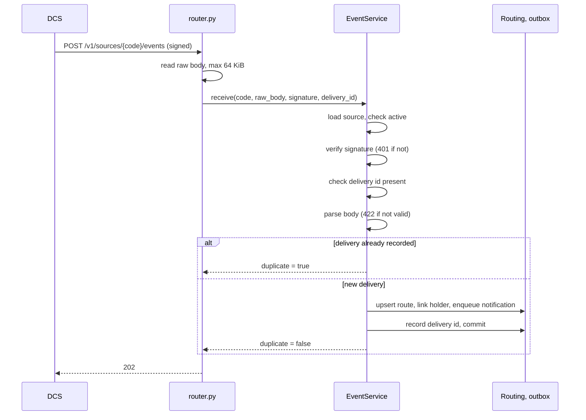

# Events

> Package: `app/features/events/`
> Last updated: 2026-10-28

## Overview

The webhook receiver. A DCS source posts a signed event when a credential
is issued or revoked, or when a credential request is created or updated.
The connector verifies the signature, records the delivery id, updates the
routing table, and queues a notification for the holder service. The
response is `202 Accepted` with `duplicate` set.

The receiver stores no event payloads. It keeps the delivery id, the
source, and the event type. Holder emails are hashed before they reach the
routing table.

## Endpoints

| Method | Path | Summary | Auth / permission |
|---|---|---|---|
| POST | `/v1/sources/{source_code}/events` | Receive an event from a DCS source | `X-EveryCRED-Signature` (HMAC) |

### `POST /v1/sources/{source_code}/events`

Headers sent by the DCS:

```
Content-Type: application/json
X-EveryCRED-Event: credential.issued
X-EveryCRED-Delivery: <unique id, reused on retries>
X-EveryCRED-Signature: t=<unix seconds>,v1=<hex HMAC-SHA256>
```

The signature covers `"<t>.<raw body>"` with the source's webhook secret.
The raw bytes are read before parsing, so the body must be signed as sent.

Body:

```json
{
  "id": "6f37b4e671f344f99e4a0736491737ea",
  "event": "credential.issued",
  "created_at": "2026-10-21T10:00:00+00:00",
  "data": {
    "credential_id": "00000000-0000-0000-0000-000000000000",
    "request_id": null,
    "holder_email": "holder@example.com",
    "status": "issued"
  }
}
```

| Event | Required in `data` | Effect |
|---|---|---|
| `credential.issued` | `credential_id` | Creates or updates the route with status `issued` |
| `credential.revoked` | `credential_id` | Updates the route with status `revoked` |
| `request.created` | `request_id` | Links the holder to the source |
| `request.updated` | `request_id` | Links the holder to the source |
| `holder.invited` | `holder_email` | Links the holder to the source; forwards `inviter_name` |

`holder_email` is optional. When present, it is normalised (trimmed,
lower-cased), hashed, and used to link the holder. It is also forwarded to
the holder service in the outbox.

Identifiers must match `^[A-Za-z0-9._:-]{1,128}$`. The
`X-EveryCRED-Delivery` header must match the same pattern.

Response `202 Accepted`:

```json
{
  "accepted": true,
  "duplicate": false
}
```

Example with a placeholder secret. The sample signature is computed in
code, so this is not a copy-paste value:

```python
import time

import httpx

from app.core.signatures import encode_body, sign

payload = {
    "id": "6f37b4e671f344f99e4a0736491737ea",
    "event": "credential.issued",
    "created_at": "2026-10-21T10:00:00+00:00",
    "data": {"credential_id": "00000000-0000-0000-0000-000000000000"},
}
body = encode_body(payload)
headers = {
    "Content-Type": "application/json",
    "X-EveryCRED-Event": "credential.issued",
    "X-EveryCRED-Delivery": payload["id"],
    "X-EveryCRED-Signature": sign(
        "whsec_<your-secret>", int(time.time()), body
    ),
}
httpx.post(
    "https://connector.example.com/v1/sources/dcs-india/events",
    content=body,
    headers=headers,
)
```

Errors:

| Status | `error.code` | When |
|---|---|---|
| 400 | `source_inactive` | The source is switched off. Checked before the signature |
| 401 | `invalid_signature` | Signature header missing, wrong, or older than the tolerance. Also when `X-EveryCRED-Delivery` is missing, after the signature check passes |
| 404 | `source_not_found` | No source has this code |
| 409 | `credential_source_conflict` | The credential is already routed to another source |
| 413 | `payload_too_large` | Body over 64 KiB. Read before the signature is checked |
| 422 | `invalid_event` | Body is not a valid event. The message names the failing fields only |
| 422 | `validation_error` | `X-EveryCRED-Signature` over 200 characters, or a bad delivery id pattern, or bad source code |

Error bodies follow the envelope in [exceptions](../core/exceptions.md).

## Flow



Step detail:

1. The source is loaded. Unknown code gives 404 before any signature
   check, so the existence of a source is visible to anyone.
2. An inactive source gives 400 before the signature check.
3. `_verify_signature` decrypts the source's webhook secret and checks the
   header with `is_signature_valid`.
4. The delivery id is required. A missing id gives 401 `invalid_signature`
   with the message about the header.
5. The body is parsed by `SourceEventPayload`. Credential events must have
   `data.credential_id`. Request events must have `data.request_id`.
   `holder.invited` must have `data.holder_email`; `data.inviter_name` is
   optional, up to 200 characters.
6. `EventService.receive` checks `SourceEventRepository.exists`. A repeat
   returns `duplicate=true` without changing anything.
7. For a new delivery, `_apply` runs:
   - For credential events: the route is created or updated. A route that
     belongs to another source gives 409. The holder key is set when the
     event carries an email.
   - When an email is present: the holder is linked to the source
     (`HolderLink`) and a notification is queued with `NotificationService.enqueue`.
8. The delivery is recorded and the transaction commits. If a concurrent
   retry of the same delivery committed first, `IntegrityError` is caught,
   the transaction is rolled back, and `duplicate=true` is returned.

The `X-EveryCRED-Event` header is not read. The event type comes from the
body.

## Data model

Table `source_events` (`SourceEvent`): `id`, `source_id` (FK to
`sources`, cascade delete), `delivery_id` (string 128), `event` (string
50), `received_at`. Unique on (`source_id`, `delivery_id`).

Writes to `credential_routes`, `holder_links`, and `holder_notifications`
happen in the same transaction. See [routing](routing.md) and
[notifications](notifications.md).

## Configuration

| Env var | Default | Purpose |
|---|---|---|
| `WEBHOOK_TOLERANCE_SECONDS` | `300` | Largest accepted difference between the signed timestamp and now. Range 30 to 3600 |
| `HOLDER_KEY_SECRET` | (required) | Hashes holder emails |
| `HOLDER_SERVICE_WEBHOOK_URL` | unset | When unset, notifications are not queued |

The body limit (`MAX_EVENT_BODY_BYTES`, 64 KiB) is a constant in
`router.py`, not a setting.

## Design decisions

- **Raw body, signed bytes.** The route reads `request.stream()` instead
  of a Pydantic model, so the signature is checked against the exact bytes
  received.
- **Signature before parsing.** An unauthenticated caller cannot reach the
  JSON parser or the database writes.
- **Delivery id is the idempotency key.** DCS retries keep the same id.
  The unique constraint plus the `IntegrityError` path covers concurrent
  retries.
- **One transaction per delivery.** The route, link, outbox row, and
  delivery record either all commit or none do, so a retry after a failure
  applies the delivery again from the start.
- **Holder emails are hashed, not stored.** See [routing](routing.md).

## Known limitations

- Source existence is visible: an unknown code returns 404, and an active
  source with a bad signature returns 401.
- A valid signature with no delivery id returns 401, not 422. The
  signature check runs first.
- Events carry only identifiers. Anything that needs the credential
  content comes from a later lookup.
- Outbox rows are written only when `HOLDER_SERVICE_WEBHOOK_URL` is set.
  Routes and links are written either way. See
  [notifications](notifications.md).

## Testing

- `tests/features/events/test_events.py`:
  `test_issued_event_creates_route_link_and_notification`,
  `test_revoked_event_updates_the_route_status`,
  `test_wrong_signature_is_rejected`,
  `test_stale_signature_is_rejected`,
  `test_repeated_delivery_is_applied_once`,
  `test_credential_owned_by_another_source_is_a_conflict`,
  `test_credential_event_without_credential_id_is_invalid`,
  `test_request_event_links_holder_without_a_route`,
  `test_unknown_source_is_not_found`.
- Signing helpers are in `app/core/signatures.py`.
