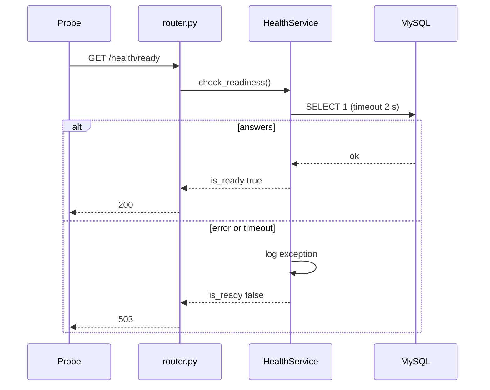

# Health

> Package: `app/features/health/`
> Last updated: 2026-10-21

## Overview

Liveness and readiness probes for the load balancer and the orchestrator.
The routes sit at the root, outside `/v1`, so probes do not depend on API
versioning. They require no authentication.

Liveness checks nothing external. Readiness checks the database. A database
outage therefore marks the pod not ready without restarting it.

## Endpoints

| Method | Path | Summary | Auth / permission |
|---|---|---|---|
| GET | `/health/live` | Check that the process is running | None |
| GET | `/health/ready` | Check that dependencies are reachable | None |

### `GET /health/live`

Always `200 OK`:

```json
{"status": "ok"}
```

### `GET /health/ready`

Runs `SELECT 1` through `ping_database`, with a 2-second limit.

Response `200 OK` when the database answers:

```json
{
  "is_ready": true,
  "components": {"database": "ok"}
}
```

Response `503 Service Unavailable` when it does not:

```json
{
  "is_ready": false,
  "components": {"database": "unavailable"}
}
```

The body never contains the connection string or a driver message. Those
go to the log.

```bash
curl -i http://127.0.0.1:8000/health/ready
```

## Flow



`HealthService` takes the engine from `DbEngine`, the engine that the
lifespan stored on `request.state`. The check does not use a request
session.

## Data model

None.

## Configuration

| Env var | Default | Purpose |
|---|---|---|
| `DATABASE_URL` | (required) | Target of the check |

`DATABASE_CHECK_TIMEOUT_SECONDS` (2.0) is a constant in `service.py`. Keep
it below the probe's timeout so the endpoint answers "not ready" instead
of the probe timing out.

## Design decisions

- **Liveness is local.** If liveness depended on the database, a database
  outage would restart every pod, which would not fix the database.
- **Readiness reports components by name only.** Probe responses are
  often logged by the platform, so they carry no detail beyond
  `ok` or `unavailable`.
- **Broad exception catch in the database check.** Any failure, whatever
  the driver raises, means "not ready". The probe must answer.
- **Not under `/v1`.** Probe paths stay stable across API versions.

## Known limitations

- Readiness does not check the holder service or any DCS source. Those
  failures show up as failed deliveries or 502 responses, not as an
  unready pod.
- The worker has its own health check (`python -m app.worker --check`),
  which reads a heartbeat file. See [notifications](notifications.md).

## Testing

`tests/features/health/test_router.py`:

- `test_liveness_returns_ok`
- `test_readiness_returns_200_when_database_is_reachable`
- `test_readiness_returns_503_when_database_is_unavailable`
