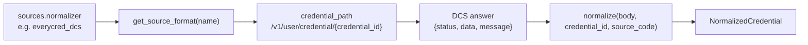

# Normalizers

> Package: `app/normalizers/`
> Last updated: 2026-10-21

## Overview

Each DCS answers a credential request in its own format. A normalizer
turns one raw answer into `NormalizedCredential`, the standard shape that
verifiers and the holder service read. A source names its format in
`sources.normalizer`. The format also fixes the path the connector requests
for a single credential.

Today there is one format, `everycred_dcs`, for the EveryCRED DCS backend.

## Endpoints

None. Normalizers are used by [credentials](credentials.md) when a
credential is fetched.

## Flow



Import order matters. `app/main.py` runs `import app.normalizers`, which
imports each module listed in `app/normalizers/__init__.py`. Importing a
module runs its decorator, which registers the format. The worker does not
import normalizers, because it does not read credentials.

## Public API

### `NormalizedCredential`

Pydantic model in `base.py`. Fields:

| Field | Type | Notes |
|---|---|---|
| `credential_id` | str | Id the caller asked for |
| `source_code` | str | Source that answered |
| `status` | `CredentialStatus` | `issued` or `revoked` |
| `title` | str or null | |
| `holder_name` | str or null | |
| `issuer` | `IssuerSummary` | `name`, `did`, `email`, `logo_url`, `description`. Each nullable |
| `issued_at` | str or null | Passed through as text |
| `fields` | object | Credential fields, empty when missing |
| `credential_url` | str or null | |
| `image_url` | str or null | |
| `qr_code_url` | str or null | |
| `hash` | str or null | |
| `credential_json` | object or null | The credential document, when it parses |

### `CredentialStatus`

`StrEnum` with `ISSUED = "issued"` and `REVOKED = "revoked"`.

### `NormalizationError`

Raised by a normalizer when the answer does not have the expected shape.
`CredentialService` turns it into `InvalidSourceResponseError` (502).

### `Normalizer` and `SourceFormat`

`Normalizer` is `Callable[[dict, str, str], NormalizedCredential]`, which
takes the decoded body, the credential id, and the source code.

`SourceFormat` is a frozen dataclass with:

- `credential_path`: template with `{credential_id}`, relative to the
  source's `base_url`.
- `normalize`: the normalizer function.
- `build_credential_path(credential_id)`: fills the template.

### `register_normalizer(name, credential_path)`

Decorator that stores a `SourceFormat` under `name`. Registering the same
name twice raises `ValueError` at import time.

### `get_source_format(name) -> SourceFormat`

Returns the registered format. Raises `KeyError` for an unknown name.

### `is_normalizer_known(name) -> bool`

Used by `SourceService` to reject unknown names when a source is created or
updated (`400 unknown_normalizer`).

### `everycred_dcs`

`app/normalizers/everycred_dcs.py`. Registered with
`credential_path="/v1/user/credential/{credential_id}"`.

It reads the DCS envelope `{"status", "data", "message"}`:

- `data` must be an object. Otherwise `NormalizationError`.
- `is_revoked` true gives `revoked`; anything else gives `issued`.
- Empty strings become `null`, so clients make one null check.
- `fields` must be an object, otherwise `{}`.
- `credential_json_content` is parsed when it is a JSON object string. A
  string that does not parse gives `null`.

## How it works

1. A source is saved with a normalizer name, which `SourceService`
   validates with `is_normalizer_known`.
2. On a lookup, `CredentialService._fetch` calls `get_source_format`, then
   `build_credential_path`.
3. `SourceCaller.call` sends the request.
4. `normalize(body, credential_id, source.code)` builds the response. A
   `NormalizationError` or `ValueError` becomes `InvalidSourceResponseError`.

## Configuration

None. The name of each source's format is stored per source
(`sources.normalizer`, default `everycred_dcs`).

## Failure modes

| Situation | Behaviour | Logged as |
|---|---|---|
| Body is not an object with a `data` object | `NormalizationError`, 502 `invalid_source_response` | `WARNING` |
| Name not registered when reading | `KeyError` from `get_source_format`, unhandled, 500 | `ERROR` with traceback |
| Name registered twice | `ValueError` at import time, app does not start | Traceback |

## Verification analytics path

`register_normalizer` takes an optional `verification_analytics_path`
template with a `{credential_id}` placeholder. When set, the connector
forwards verification records for the format's credentials there (see
[credentials.md](credentials.md)). Ids are URL-encoded into both
templates by `SourceFormat`.

## Adding a source format

1. **Write the function** in a new module, for example
   `app/normalizers/other_dcs.py`. Match this signature:

   ```python
   from typing import Any

   from app.normalizers.base import (
       CredentialStatus,
       NormalizationError,
       NormalizedCredential,
       register_normalizer,
   )


   @register_normalizer(
       "other_dcs", credential_path="/api/credentials/{credential_id}"
   )
   def normalize_other_dcs(
       raw_response: dict[str, Any], credential_id: str, source_code: str
   ) -> NormalizedCredential:
       """Map the other DCS answer to the standard format.

       Raises:
           NormalizationError: The answer does not have the expected shape.
       """
       record = raw_response.get("record")
       if not isinstance(record, dict):
           raise NormalizationError("record is missing")
       return NormalizedCredential(
           credential_id=credential_id,
           source_code=source_code,
           status=CredentialStatus.ISSUED,
           title=record.get("title"),
       )
   ```

2. **Import it** in `app/normalizers/__init__.py`:

   ```python
   from app.normalizers import everycred_dcs, other_dcs  # noqa: F401
   ```

3. **Add tests** under `tests/normalizers/`, following
   `tests/normalizers/test_everycred_dcs.py`. Cover the path, a complete
   answer, empty values, and a missing object.

4. **Register the source** with the new name in `normalizer`. The name is
   checked against the registry on create and update.

Rules for normalizers:

- Read only what the standard format needs. Ignore the rest.
- Return `null`, not `""`, for missing values.
- Raise `NormalizationError` for bad shapes. Do not let `KeyError` or
  `TypeError` escape, although `_fetch` also catches `ValueError`.
- Do not fetch anything else from inside a normalizer. It receives the
  body and nothing more.
- Do not store the body. The credential is returned and discarded.

## Known limitations

- The registry is process-wide and filled at import time. A new format
  needs a deploy, not a database change.
- `KeyError` for an unregistered name is not translated into an
  `AppError`. A source whose format was removed from code returns 500
  until its normalizer is changed.
- `credential_json` is returned as parsed JSON. Its size is not limited
  beyond the source's own response size.

## Testing

`tests/normalizers/test_everycred_dcs.py`:

- `test_dcs_format_builds_the_verifier_path`
- `test_empty_strings_become_null`
- `test_unparseable_credential_json_is_dropped`
- `test_missing_data_raises`

The end-to-end path is covered by
`tests/features/credentials/test_credentials.py`.
