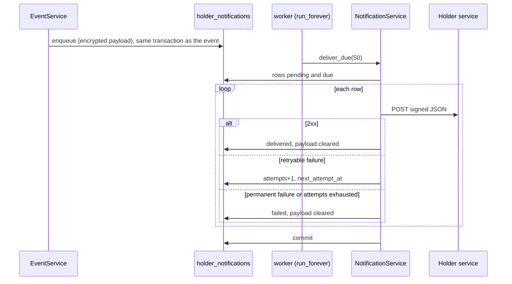

# Notifications

> Package: `app/features/notifications/`, worker: `app/worker.py`
> Last updated: 2026-10-21

## Overview

Forwards credential and request events to the holder service as signed
webhooks. The webhook receiver writes each event to an outbox table in the
same transaction that records the delivery. A separate worker process
sends due rows and retries failures with backoff. A slow or unavailable
holder service therefore never makes a DCS webhook fail.

Two parts:

- `NotificationService` (`service.py`): queues rows and delivers them.
- `app/worker.py`: runs `deliver_due` on a loop, and reports its health
  through a heartbeat file.

## Endpoints

None. Events come in through [events](events.md). Delivery runs in the
worker.

## Flow



### Enqueue

`NotificationService.enqueue(event, data)` runs inside
`EventService._apply`. It creates a `HolderNotification` with a payload:

```json
{
  "id": "6f37b4e671f344f99e4a0736491737ea",
  "event": "credential.issued",
  "created_at": "2026-10-21T10:00:00.000000+00:00",
  "data": {
    "source_code": "dcs-india",
    "holder_email": "holder@example.com",
    "credential_id": "00000000-0000-0000-0000-000000000000",
    "request_id": null,
    "status": "issued"
  }
}
```

The payload is JSON encrypted with `encrypt_text` and stored in
`encrypted_payload`. Enqueue does not commit. The event service commits.

When `HOLDER_SERVICE_WEBHOOK_URL` is unset, `enqueue` returns without
writing anything.

### Delivery

`deliver_due(batch_size)` loads up to `batch_size` rows (50 in the worker)
where `status = pending` and `next_attempt_at <= now`, oldest first. Each
row is delivered once per round:

1. Decrypt the payload and parse it.
2. POST the body to `HOLDER_SERVICE_WEBHOOK_URL` with:

   | Header | Value |
   |---|---|
   | `Content-Type` | `application/json` |
   | `X-EveryCRED-Event` | The event name |
   | `X-EveryCRED-Delivery` | The payload `id` |
   | `X-EveryCRED-Signature` | `t=<now>,v1=<HMAC>`, signed with `HOLDER_SERVICE_WEBHOOK_SECRET` |

   The body is `encode_body(payload)`: compact JSON, sorted keys. See
   [signatures](../core/signatures.md).

3. Outcome:

| Result | Effect on the row |
|---|---|
| 2xx | `delivered`, `delivered_at` set, payload cleared |
| Timeout, transport error | `attempts` +1, retried |
| 5xx, 408, 429 | `attempts` +1, retried |
| Other 4xx | `failed` at once, payload cleared |
| Attempts reach `NOTIFICATION_MAX_ATTEMPTS` | `failed`, payload cleared |

`last_error` holds the reason, cut to 255 characters.

Retry delays after each failed attempt:

| Attempt that failed | Next try after |
|---|---|
| 1 | 30 s |
| 2 | 120 s |
| 3 | 600 s |
| 4 | 1800 s |
| 5 and later | 3600 s |

The default `NOTIFICATION_MAX_ATTEMPTS=8` means a row is given up after
the eighth failed attempt.

The `deliver_due` call commits once at the end of the batch. Each row's
changes are written in that commit.

### Worker

`python -m app.worker` runs `run_forever`:

- Creates its own engine, session factory, and HTTP client.
- Every `WORKER_INTERVAL_SECONDS`, runs `run_once` (one `deliver_due`
  batch of 50) in a new session.
- After a round without an exception, touches the heartbeat file
  `<tmpdir>/everycred-connector-heartbeat`.
- A failed round is logged with `logger.exception` and the loop continues.
- On SIGINT or SIGTERM it stops after the current wait and closes the
  client and engine.

`python -m app.worker --check` exits `0` when the heartbeat file is no
older than 120 seconds, and `1` otherwise. The Compose file uses it as the
worker's health check.

If `HOLDER_SERVICE_WEBHOOK_URL` is unset, the worker logs a warning at
start and still runs its rounds. Those rounds do nothing and still touch
the heartbeat.

Run locally:

```bash
uv run python -m app.worker
```

## Data model

Table `holder_notifications` (`HolderNotification`):

| Column | Type | Notes |
|---|---|---|
| `id` | UUID | Primary key. Also the payload `id` as hex |
| `event` | string(50) | Event name |
| `encrypted_payload` | text, nullable | Cleared on delivered or failed |
| `status` | enum: `pending`, `delivered`, `failed` | Indexed. Default `pending` |
| `attempts` | int | Failed attempts so far |
| `next_attempt_at` | UTC datetime | Indexed. When the row becomes due |
| `last_error` | string(255), nullable | Last failure reason |
| `delivered_at` | UTC datetime, nullable | |
| `created_at`, `updated_at` | UTC datetime | |

The payload holds the holder's email. It is encrypted at rest and removed
once the row is finished, so the outbox does not keep addresses after
delivery.

## Configuration

| Env var | Default | Purpose |
|---|---|---|
| `HOLDER_SERVICE_WEBHOOK_URL` | unset | Holder service endpoint. Unset means nothing is queued |
| `HOLDER_SERVICE_WEBHOOK_SECRET` | unset | Signing secret. At least 32 characters. Required with the URL |
| `NOTIFICATION_TIMEOUT_SECONDS` | `10.0` | Timeout per delivery, max 60 |
| `NOTIFICATION_MAX_ATTEMPTS` | `8` | Attempts before a row is `failed`, 1 to 20 |
| `WORKER_INTERVAL_SECONDS` | `5.0` | Pause between rounds, max 300 |
| `DATA_ENCRYPTION_KEYS` | (required) | Encrypts the payload |

Constants in code: `BATCH_SIZE = 50`, `HEARTBEAT_MAX_AGE_SECONDS = 120`,
`RETRY_DELAYS_SECONDS` in `service.py`.

The holder service's receiving endpoint is described in
[`.env.example`](../../.env.example) (`POST /v1/connector/events`, signed
with the shared secret). Its side of the contract is not in this
repository; it lives in `everycred-holder-service`.

## Design decisions

- **Outbox, not direct calls.** The event is committed with the route and
  the outbox row. A process crash between the two cannot lose a
  notification, and the DCS webhook does not wait on the holder service.
- **Payload cleared on completion.** Once delivered or abandoned, the row
  keeps only ids, status, and error text.
- **Retries stop at the first permanent 4xx.** A 400 or 404 from the
  holder service will not change by retrying, so the row fails at once.
  408 and 429 are treated as temporary.
- **Heartbeat, not a port.** The worker has no HTTP server. A file touched
  after each good round gives the orchestrator something to check.

## Known limitations

- **Duplicate sends are possible.** Rows are not locked. Two worker
  processes can pick the same row, and a crash after a successful POST but
  before the batch commit sends the row again. The holder service must
  treat `X-EveryCRED-Delivery` as an idempotency key. Run one worker per
  deployment.
- **Events are not queued when the URL is unset.** `enqueue` returns
  early and writes nothing; routes and links are still saved. Events
  received while the URL is unset are not delivered later.
- The worker does not retry sends after a round fails with an exception,
  such as a database outage, until the next round.

## Testing

`tests/features/notifications/test_delivery.py`:

- `test_worker_delivers_a_signed_event_and_clears_the_payload`
- `test_server_error_is_retried_later`
- `test_client_error_fails_without_retry`

The worker loop, `is_healthy`, and `--check` have no test yet. Worth adding tests
for `is_healthy` with a file older than `HEARTBEAT_MAX_AGE_SECONDS`.
