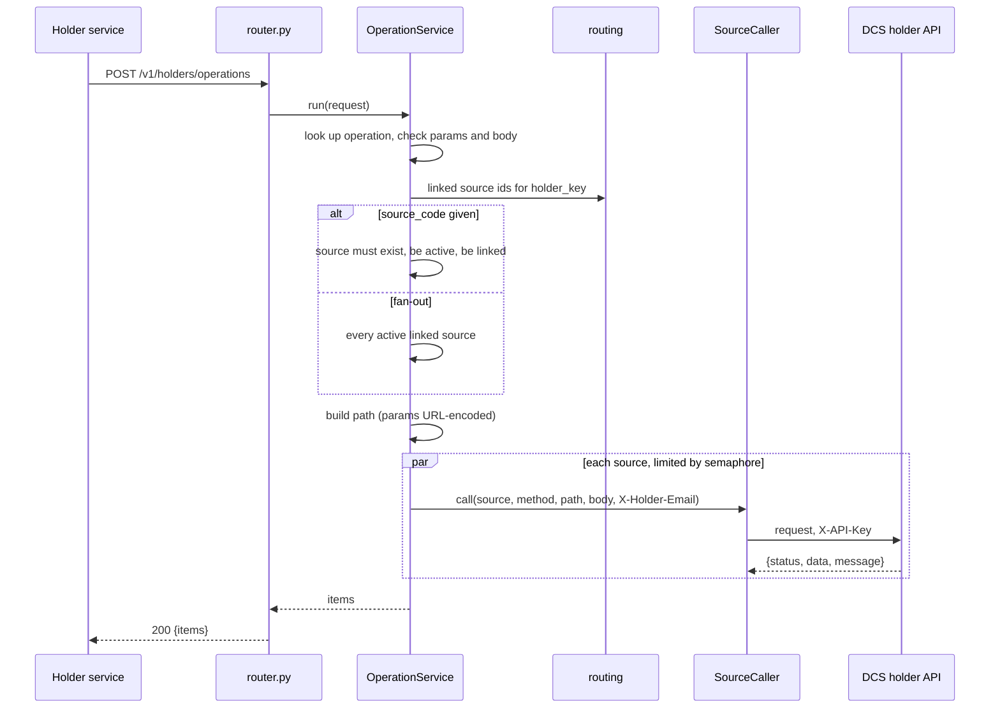

# Operations

> Package: `app/features/operations/`
> Last updated: 2026-10-21

## Overview

Holder operations let the holder service act on a holder's data that
lives in a DCS: listing and submitting requests, running workflow steps,
KYC detail, integration steps, DigiLocker, and credential stats. The
holder service names an operation from the catalog. It never sends a
path. The connector picks the source, calls the DCS holder API, and
passes the answer back without storing it.

Only the holder service may call this feature.

## Endpoints

| Method | Path | Summary | Auth / permission |
|---|---|---|---|
| POST | `/v1/holders/operations` | Run a holder operation on DCS sources | Holder service (`X-API-Key`) |

### `POST /v1/holders/operations`

Request:

```json
{
  "holder_email": "holder@example.com",
  "operation": "requests.get",
  "source_code": "dcs-india",
  "params": {"request_id": "00000000-0000-0000-0000-000000000000"},
  "body": null
}
```

| Field | Rules |
|---|---|
| `holder_email` | Valid email, max 320 characters |
| `operation` | A name in the catalog below. Max 50 characters |
| `source_code` | Required for item operations. Optional for fan-out operations |
| `params` | Must have exactly the names the operation declares. At most 10 entries. Values match `Identifier` |
| `body` | JSON object. Only for operations that take a body. At most 256 KiB when serialised |

Response `200 OK`:

```json
{
  "items": [
    {
      "source_code": "dcs-india",
      "status_code": 200,
      "ok": true,
      "data": {"id": "00000000-0000-0000-0000-000000000000", "status": "pending"},
      "message": null
    }
  ]
}
```

One item per source called. For a fan-out with no linked sources the
result is `{"items": []}`. A source that fails at the transport level
gives an item with `status_code: 502`, `ok: false`, and a `message`.
The request still returns 200.

`data` is the `data` field of the DCS envelope. `message` is the DCS
`message` when it is a string. For a DCS answer without that envelope,
`data` is the whole body.

Errors:

| Status | `error.code` | When |
|---|---|---|
| 400 | `unknown_operation` | Name not in the catalog |
| 400 | `invalid_params` | Param names do not match, or a body is sent to an operation without one, or the body is too large |
| 400 | `source_required` | Item operation with no `source_code` |
| 400 | `source_inactive` | The named source is switched off |
| 401 | `authentication_failed` | Missing or wrong `X-API-Key` |
| 403 | `permission_denied` | Verifier client |
| 404 | `source_not_found` | Named source does not exist |
| 404 | `holder_not_linked` | The source has never reported this holder |
| 422 | `validation_error` | Field rules fail |

## Catalog

Defined in `app/features/operations/catalog.py`. Paths are relative to
`/v1/internal/holder` on the DCS (see [dcs_contract.md](../dcs_contract.md)).

| Operation | Method | Path template | Params | Body | Fan-out |
|---|---|---|---|---|---|
| `requests.list` | GET | `/requests` | none | no | yes |
| `requests.get` | GET | `/requests/{request_id}` | `request_id` | no | no |
| `requests.fields` | GET | `/requests/{request_id}/fields` | `request_id` | no | no |
| `requests.submit` | POST | `/requests/{request_id}/submission` | `request_id` | yes | no |
| `requests.decline` | POST | `/requests/{request_id}/decline` | `request_id` | yes | no |
| `kyc.detail` | GET | `/kyc-detail` | none | no | no |
| `workflow.list` | GET | `/workflow-requests` | none | no | yes |
| `workflow.get` | GET | `/workflow-requests/{request_uuid}` | `request_uuid` | no | no |
| `workflow.consent` | POST | `/workflow-requests/{request_uuid}/consent` | `request_uuid` | yes | no |
| `workflow.node_submit` | POST | `/workflow-requests/{request_uuid}/nodes/{node_key}/submit` | `request_uuid`, `node_key` | yes | no |
| `workflow.node_accept` | POST | `/workflow-requests/{request_uuid}/nodes/{node_key}/accept` | `request_uuid`, `node_key` | yes | no |
| `workflow.node_decline` | POST | `/workflow-requests/{request_uuid}/nodes/{node_key}/decline` | `request_uuid`, `node_key` | yes | no |
| `integrations.list` | GET | `/requests/{request_id}/integration` | `request_id` | no | no |
| `integrations.start` | POST | `/requests/{request_id}/integration/{integration_type}/{tool_code}/{flow}/start` | `request_id`, `integration_type`, `tool_code`, `flow` | yes | no |
| `integrations.inputs` | POST | `/requests/{request_id}/integration/{integration_type}/{tool_code}/{flow}/inputs` | same four | yes | no |
| `integrations.cancel` | POST | `/requests/{request_id}/integration/{integration_type}/{tool_code}/{flow}/cancel` | same four | yes | no |
| `digilocker.initialize` | POST | `/digilocker/initialize` | none | yes | no |
| `digilocker.complete` | GET | `/digilocker/complete-flow/{client_id}` | `client_id` | no | no |
| `credentials.stats` | GET | `/credentials/{credential_id}/stats` | `credential_id` | no | no |

A fan-out operation may still name a `source_code`. Only item
operations must have one.

Example request for a list across all linked sources:

```bash
curl -X POST https://connector.example.com/v1/holders/operations \
  -H "X-API-Key: <your-holder-service-key>" \
  -H "Content-Type: application/json" \
  -d '{"holder_email": "holder@example.com", "operation": "requests.list"}'
```

## Flow



Rules applied in `_check_request`, in this order:

1. The param names must equal the operation's declared names.
2. A body is allowed only when the operation has one.
3. A body larger than 256 KiB is refused.
4. An item operation needs a `source_code`.

`_resolve_sources` then applies the holder rules:

- Fan-out with no `source_code`: every linked source that is active.
- Named source: must exist, be active, and be linked to the holder.

Each call sends the holder's normalised email as `X-Holder-Email`. The DCS
uses it to scope the query. Failures in one source are returned in its
item and never fail the others.

## Data model

No tables. The holder's links come from `holder_links` (see
[routing](routing.md)). Answers are not stored.

## Configuration

| Env var | Default | Purpose |
|---|---|---|
| `SOURCE_TIMEOUT_SECONDS` | `10.0` | Timeout per source call |
| `SOURCE_MAX_CONCURRENT_CALLS` | `5` | Concurrent calls per request |
| `HOLDER_KEY_SECRET` | (required) | Matches the holder to links |

## Design decisions

- **Catalog, not pass-through.** The holder service names an operation,
  and the connector owns the path. Widening what the holder service can
  reach is a code change to `catalog.py`, reviewed like any other.
- **Path parameters are encoded.** `build_path` quotes each value with
  `safe=""`. Values are also limited to `Identifier`, so `/` and `..`
  cannot reach a path.
- **Per-source status is kept.** The caller gets each DCS status code, so
  a 404 from one source does not look like a failure of the whole call.
- **Linked sources only.** A holder's operations never reach a source
  that has not reported that holder. This limits fan-out.

## Known limitations

- Adding an operation needs the matching route on the DCS. See
  [dcs_contract.md](../dcs_contract.md).
- Fan-out waits for the slowest source, up to `SOURCE_TIMEOUT_SECONDS`.
- The body limit counts `json.dumps` length, not the bytes the caller
  sent. It is approximate for non-ASCII content.
- A `POST` that times out may have been applied by the DCS. The connector
  does not retry, and reports `502` for that source.

## Testing

`tests/features/operations/test_operations.py`:

- `test_item_operation_calls_the_named_source`
- `test_list_operation_fans_out_to_linked_sources`
- `test_invalid_operation_requests_are_rejected`
- `test_path_traversal_in_params_is_rejected`
- `test_source_without_holder_records_is_refused`
