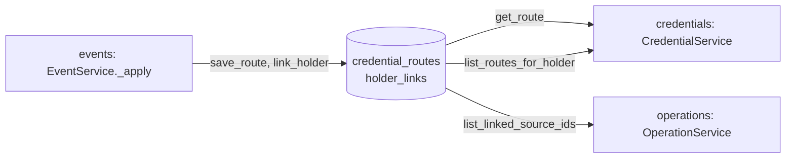

# Routing

> Package: `app/features/routing/`
> Last updated: 2026-10-21

## Overview

The routing table answers two questions for the rest of the service:

- Which source issued this credential? (`credential_routes`)
- Which sources have sent events about this holder? (`holder_links`)

The table holds identifiers and statuses only. It never holds credential
contents, and it never holds a holder's email address. Holders are
identified by `holder_key()`, a keyed hash of the normalised email.

This feature has no HTTP routes. Writes happen inside the event receiver,
and reads happen in the credentials and operations features.

## Endpoints

None. The routing table is reached through the features listed under
Flow.

## Flow



Writes:

- `RoutingRepository.save_route` creates a route, or updates `status`,
  `last_event_at`, and `holder_key` (only when a new hash is given). It
  never changes `source_id`. The caller checks that first.
- `RoutingRepository.link_holder` adds a `HolderLink` unless one already
  exists.

Reads:

- `get_route(credential_id)` for lookups by id.
- `list_routes_for_holder(holder_key, limit)` for a holder's credentials,
  newest event first.
- `list_linked_source_ids(holder_key)` for operations and fan-out.
- `is_holder_linked(holder_key, source_id)` for a single-source check.

## Holder keys

`app/features/routing/holder_keys.py`:

- `normalise_email(email)` returns `email.strip().lower()`.
- `holder_key(email, settings)` returns the hex HMAC-SHA256 of the
  normalised email, keyed with `HOLDER_KEY_SECRET`.

```python
from app.features.routing.holder_keys import holder_key

key = holder_key("Holder@Example.com", settings)
# Same key as holder_key("holder@example.com", settings).
```

The same email always produces the same key, so the routing table can be
joined on it. The key cannot be turned back into an email without the
secret.

## Data model

Table `credential_routes` (`CredentialRoute`):

| Column | Type | Notes |
|---|---|---|
| `id` | UUID | Primary key |
| `credential_id` | string(128) | Unique, indexed |
| `source_id` | UUID | FK to `sources`, cascade delete, indexed |
| `holder_key` | string(64), nullable | Indexed. Null when the event had no email |
| `status` | string(20) | `issued` or `revoked` |
| `last_event_at` | UTC datetime | Set on each credential event |
| `created_at`, `updated_at` | UTC datetime | |

Table `holder_links` (`HolderLink`):

| Column | Type | Notes |
|---|---|---|
| `id` | UUID | Primary key |
| `holder_key` | string(64) | Indexed |
| `source_id` | UUID | FK to `sources`, cascade delete |
| `created_at` | UTC datetime | |

Unique on (`holder_key`, `source_id`).

Both tables are created by
`migrations/versions/2026_10_21_1602-748c4dbd1658_create_connector_tables.py`.

## Configuration

| Env var | Default | Purpose |
|---|---|---|
| `HOLDER_KEY_SECRET` | (required) | Key for `holder_key()`. Changing it orphans every link |

## Design decisions

- **Hashed holder identity.** The routing table is the only place that
  relates a credential to a holder. Keeping a hash there means a database
  dump does not expose addresses. The keyed hash, unlike a plain hash, cannot
  be checked against a list of known emails without the secret.
- **Source is fixed at first write.** A credential cannot move between
  sources. Moving it would let one source take over another's routes.
- **Holder key is kept once known.** A later event without an email does
  not erase the link.
- **Links are per source.** Fan-out operations call only the sources that
  have sent events about the holder, not every registered source.

## Known limitations

- `HOLDER_KEY_SECRET` is a single key. Changing it orphans every link, and
  there is no re-keying routine.
- A route with no `holder_key` cannot be found by a holder lookup. The
  verifier path still finds it by id.
- `list_routes_for_holder` returns at most 200 routes, the limit set in
  `CredentialService`. Holders with more credentials see only the newest.

## Testing

No test file of its own. Behaviour is covered through:

- `tests/features/events/test_events.py` (route creation, status update,
  link creation, conflict).
- `tests/features/credentials/test_credentials.py`
  (`test_holder_cannot_get_another_holders_credential`,
  `test_holder_lookup_collects_from_every_source`).
- `tests/features/operations/test_operations.py`
  (`test_list_operation_fans_out_to_linked_sources`,
  `test_source_without_holder_records_is_refused`).

Not yet covered: unit tests for `holder_key` (case and whitespace normalisation).
