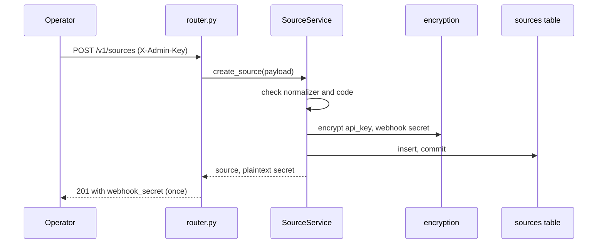

# Sources

> Package: `app/features/sources/`
> Last updated: 2026-10-21

## Overview

A source is one DCS deployment the connector routes to, such as DCS-India
or DCS-Education. Operators register sources with their base URL, the API
key the DCS expects, and the normalizer that reads its answers. The
connector returns a webhook secret at registration, which the DCS uses to
sign its events.

This feature also contains `caller.py`, the API caller. Every outbound
request to a DCS goes through `SourceCaller.call`. It adds the source's own
API key, checks that the source is active, and applies the source timeout.

## Endpoints

All routes require `X-Admin-Key`. Base path `/v1/sources`.

| Method | Path | Summary | Auth / permission |
|---|---|---|---|
| POST | `/v1/sources` | Register a DCS source | `X-Admin-Key` |
| GET | `/v1/sources` | List DCS sources | `X-Admin-Key` |
| GET | `/v1/sources/{source_code}` | Get a DCS source | `X-Admin-Key` |
| PATCH | `/v1/sources/{source_code}` | Update a DCS source | `X-Admin-Key` |
| POST | `/v1/sources/{source_code}/webhook-secret` | Rotate the webhook secret | `X-Admin-Key` |

`source_code` must match `^[a-z0-9][a-z0-9-]{1,49}$`.

### `POST /v1/sources`

Registers a source and returns its webhook secret. The secret is shown
only in this response.

Request:

```json
{
  "code": "dcs-india",
  "name": "DCS India",
  "base_url": "https://dcs-india.example.com",
  "api_key": "<key-the-dcs-expects>",
  "normalizer": "everycred_dcs"
}
```

| Field | Rules |
|---|---|
| `code` | Pattern above. Unique |
| `name` | 1 to 150 characters |
| `base_url` | http or https. No credentials, query, or fragment. Trailing `/` is removed |
| `tenant_origin` | Optional. Scheme, host and optional port only (no path, query, credentials). Trailing `/` is removed. See [Tenants of a shared DCS](#tenants-of-a-shared-dcs) |
| `api_key` | 16 to 500 characters. Stored encrypted |
| `normalizer` | Optional. Default `everycred_dcs`. Must be a registered normalizer |

Response `201 Created`:

```json
{
  "id": "00000000-0000-0000-0000-000000000000",
  "code": "dcs-india",
  "name": "DCS India",
  "base_url": "https://dcs-india.example.com",
  "tenant_origin": null,
  "normalizer": "everycred_dcs",
  "is_active": true,
  "created_at": "2026-10-21T10:00:00Z",
  "updated_at": "2026-10-21T10:00:00Z",
  "webhook_secret": "whsec_<generated>"
}
```

Errors:

| Status | `error.code` | When |
|---|---|---|
| 400 | `unknown_normalizer` | `normalizer` is not registered |
| 401 | `authentication_failed` | Missing or wrong `X-Admin-Key` |
| 409 | `source_code_taken` | `code` already exists |
| 422 | `validation_error` | Field rules fail, including credentials in the URL |

### `GET /v1/sources`

Query: `limit` (1 to 100, default 20), `offset` (0 or more, default 0).
Sorted by `code`. Returns `Page[SourceResponse]`: `items`, `total`,
`limit`, `offset`. Items do not include either secret.

### `GET /v1/sources/{source_code}`

Returns one `SourceResponse`. Errors: 404 `source_not_found`.

### `PATCH /v1/sources/{source_code}`

Changes any of `name`, `base_url`, `tenant_origin`, `api_key`,
`normalizer`, `is_active`. Only fields present in the body change, so
`"tenant_origin": null` removes the origin and leaving it out keeps it.
Unknown fields are rejected.

Setting `is_active` to `false` stops all calls to the source. A verifier
lookup routed to it fails with 400 `source_inactive`. A holder lookup
reports `source_inactive` on that item. Incoming events from the source
are refused with 400 `source_inactive`.

Errors: 400 `unknown_normalizer`, 404 `source_not_found`.

### `POST /v1/sources/{source_code}/webhook-secret`

Issues a new `whsec_` secret and returns it in `webhook_secret`. The old
secret stops working immediately, so update the DCS in the same step.

Errors: 404 `source_not_found`.

Request example with a placeholder admin key:

```bash
curl -X POST https://connector.example.com/v1/sources \
  -H "X-Admin-Key: <your-admin-key>" \
  -H "Content-Type: application/json" \
  -d '{"code": "dcs-india", "name": "DCS India",
       "base_url": "https://dcs-india.example.com",
       "api_key": "<key-the-dcs-expects>"}'
```

## Flow



Outbound calls (`caller.py`):

1. `SourceCaller.call` raises `SourceInactiveError` when `is_active` is
   false.
2. It decrypts the API key and sends `X-API-Key`. When a holder is
   involved it also sends `X-Holder-Email`. When the source has a
   `tenant_origin` it is sent as `Origin`.
3. The request goes to `f"{source.base_url}{path}"` with the source
   timeout (`SOURCE_TIMEOUT_SECONDS`).
4. A timeout or transport error raises `SourceUnavailableError`.
5. A body that is not JSON raises `SourceUnavailableError`.
6. Any HTTP status, including 4xx and 5xx, is returned as a
   `SourceResponse`. The caller decides what that status means.

`caller.py` builds no paths of its own. Callers pass a path from a fixed
template: a normalizer's `credential_path`, or an operation from
`app/features/operations/catalog.py`.

### Tenants of a shared DCS

One DCS backend can serve several tenants, each with its own database.
The DCS picks the tenant from the user's token or, for calls without
one, from the `Origin` / `Host` header matched against its tenant
domains. The connector's calls carry no user token, and every tenant
shares the backend's host, so the connector registers **one source per
tenant** and sets `tenant_origin` to that tenant's frontend origin (the
domain stored for the tenant in the DCS):

```json
POST /v1/sources
{
  "code": "dcs-tenant-a",
  "name": "DCS tenant A",
  "base_url": "https://api.example.com",
  "tenant_origin": "https://tenant-a.example.com",
  "api_key": "<tenant A's connector_source_api_key>"
}
```

Each tenant source has its own API key and webhook secret, set in that
tenant's DCS config, so a call made with one tenant's key is refused by
another tenant. Leave `tenant_origin` empty for a DCS with one tenant,
or one whose tenants have their own API hosts.

## Data model

Table `sources` (`Source` model):

| Column | Type | Notes |
|---|---|---|
| `id` | UUID | Primary key |
| `code` | string(50) | Unique, indexed |
| `name` | string(150) | |
| `base_url` | string(500) | No trailing slash |
| `tenant_origin` | string(255), null | Sent as `Origin`; no trailing slash |
| `normalizer` | string(50) | Name of a registered normalizer |
| `encrypted_api_key` | text | Fernet ciphertext |
| `encrypted_webhook_secret` | text | Fernet ciphertext |
| `is_active` | bool | |
| `created_at`, `updated_at` | UTC datetime | |

Created by `migrations/versions/2026_10_21_1602-748c4dbd1658_create_connector_tables.py`;
`tenant_origin` added by `2026_10_30_1800-c2ba282c9fa0_source_tenant_origin.py`.
There is no delete endpoint. Sources are switched off with `is_active`.

## Configuration

| Env var | Default | Purpose |
|---|---|---|
| `SOURCE_TIMEOUT_SECONDS` | `10.0` | Timeout per call, max 60 |
| `SOURCE_MAX_CONCURRENT_CALLS` | `5` | Concurrency for fan-out calls. Used by the credentials and operations features |
| `DATA_ENCRYPTION_KEYS` | (required) | Encrypts the API key and webhook secret |

## Design decisions

- **Secrets are encrypted, not hashed.** The connector must send the API
  key and sign-check the webhook, so it needs the plaintext. See
  [encryption](../core/encryption.md).
- **Secrets are never returned after registration.** `SourceResponse`
  omits them. The webhook secret appears once, in the create and rotate
  responses.
- **No delete.** Routes and links reference sources by foreign key. Turning
  a source off with `is_active` keeps that history intact.
- **Normalizer is validated on write.** An unknown name is rejected when
  the source is saved, so later reads can rely on it being registered.

## Known limitations

- A normalizer that is removed from code while sources still name it makes
  reads fail with a `KeyError` in `CredentialService._fetch` (500).
- Changing `base_url` does not check that the new host is reachable.
- Rotating the webhook secret has no grace period. The DCS must be updated
  at once.

## Testing

- API tests: `tests/features/sources/test_sources.py`
  (`test_create_source_returns_secret_once_and_hides_api_key`,
  `test_create_source_rejects_url_with_credentials`,
  `test_rotate_webhook_secret_returns_a_new_secret`,
  `test_list_sources_is_paginated`).
- Caller behaviour is exercised through `tests/features/credentials/`,
  `tests/features/operations/`, and `tests/features/events/`.
- Manual check: the `curl` example above, against a local server with
  `uv run fastapi dev`.
