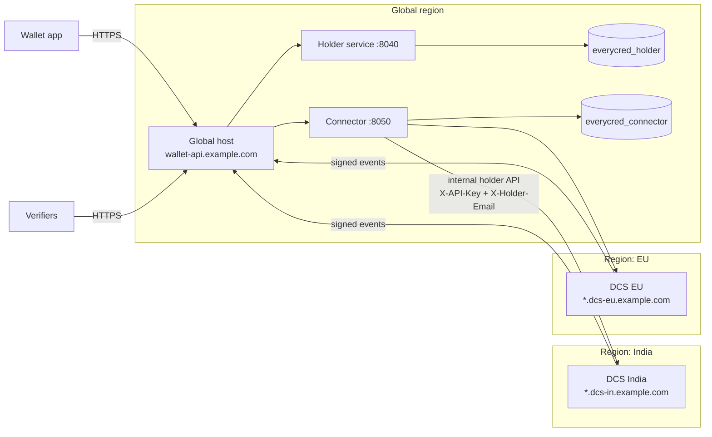

# Multi-region deployment (one global wallet)

> Last updated: 2026-10-26

How to run one global holder service and connector in front of DCS
instances in several regions, so a single wallet shows a holder's
credentials from every region. Each DCS keeps its credentials in its
own region; the global services hold routing data and holder accounts
only.

## 1. Target layout



| Host (example) | Runs | Public paths |
|---|---|---|
| `wallet-api.example.com` | Holder service, connector | `/holder/*`, `/connector/*` |
| `<tenant>.dcs-in.example.com` | DCS India (one subdomain per tenant) | DCS API; `/v1/internal/*` only for the connector |
| `<tenant>.dcs-eu.example.com` | DCS EU | Same |

Use your real domains; every name below is an example.

## 2. Before you start

- **Data residency.** Holder accounts (email, name, mobile) live in the
  global holder database, and credential content passes through the
  global services (it is not stored). For holders under India's DPDP Act
  or the EU GDPR this is a cross-border transfer: choose the global
  region and the legal basis with your compliance team first. If a
  region's rules forbid it, that region needs its own stack instead
  (option 2 in the architecture notes).
- **One connector per wallet.** All regions report to the same
  connector, so every holder gets one merged view.
- **Clocks.** Event signatures are rejected when more than
  `WEBHOOK_TOLERANCE_SECONDS` (300) apart. Run NTP (`chrony` or
  `systemd-timesyncd`) on every server.
- **Static egress IP for the global host.** Each DCS allows its internal
  API only from the connector, so the global host needs a fixed public
  IP (for example an Elastic IP).
- **HTTPS everywhere.** Events, holder emails and API keys cross the
  internet between regions.

## 3. DNS and TLS

1. Create DNS records:

   | Record | Points to |
   |---|---|
   | `wallet-api.example.com` | Global host's public IP |
   | `*.dcs-in.example.com` | DCS India load balancer or host |
   | `*.dcs-eu.example.com` | DCS EU load balancer or host |

   A DCS picks the tenant from the Host header (`TenantMiddleware`), so
   each tenant needs its own subdomain. A bare IP resolves no tenant and
   falls back to the global DCS configuration.

2. Issue certificates. With certbot on nginx, for example:

   ```bash
   sudo certbot --nginx -d wallet-api.example.com
   # Wildcards need a DNS challenge:
   sudo certbot certonly --manual --preferred-challenges dns -d '*.dcs-in.example.com'
   ```

## 4. Global host: connector and holder service

Follow each repo's README and `docker compose up -d` (API, worker and
migrations start together). Then set these values.

### Connector `.env`

```env
ENVIRONMENT=production
DATABASE_URL=mysql+aiomysql://connector:<password>@host.docker.internal:3306/everycred_connector
ADMIN_API_KEY=<random, 32+ chars>
API_KEY_HASH_SECRET=<random, 32+ chars>
HOLDER_KEY_SECRET=<random, 32+ chars>      # never change after go-live
DATA_ENCRYPTION_KEYS=<Fernet key>
SOURCE_TIMEOUT_SECONDS=10                  # per DCS call; raise for distant regions
SOURCE_MAX_CONCURRENT_CALLS=5
HOLDER_SERVICE_WEBHOOK_URL=https://wallet-api.example.com/holder/v1/connector/events
HOLDER_SERVICE_WEBHOOK_SECRET=<random, 32+ chars>
CORS_ALLOWED_ORIGINS=["https://verifier.example.com"]
```

`SOURCE_TIMEOUT_SECONDS` bounds every cross-region call. A region that
does not answer in time shows up as a missing source in fan-out lists,
not as a failed list. Measure the round trip to the farthest DCS and
keep the timeout comfortably above it.

### Holder service `.env`

```env
ENVIRONMENT=production
DATABASE_URL=mysql+aiomysql://holder:<password>@host.docker.internal:3306/everycred_holder
JWT_SECRET_KEY=<random, 32+ chars>
TOKEN_HASH_SECRET=<random, 32+ chars>
CONNECTOR_BASE_URL=https://wallet-api.example.com/connector
CONNECTOR_API_KEY=<holder_service client key, step 5>
CONNECTOR_WEBHOOK_SECRET=<same as HOLDER_SERVICE_WEBHOOK_SECRET>
CONNECTOR_TIMEOUT_SECONDS=15               # above the connector's SOURCE_TIMEOUT_SECONDS
STORAGE_BACKEND=s3
AWS_REGION=<global region>
S3_BUCKET=<bucket>
EMAIL_BACKEND=smtp
SMTP_HOST=<smtp host>
VERIFIER_BASE_URL=https://verifier.example.com/
GOOGLE_CLIENT_IDS=["<web client id>","<android client id>","<ios client id>"]
```

### nginx on the global host

Use `deploy/nginx/holder-subpath.conf` from the holder service for
`/holder/`, and the same block with `/connector/` and port 8050 for the
connector, inside the `listen 443 ssl` server of
`wallet-api.example.com`.

## 5. Register clients in the connector

Run once, from any machine, with the operator key. Each answer shows the
client's `api_key` once.

```bash
CONNECTOR=https://wallet-api.example.com/connector
ADMIN=<ADMIN_API_KEY>

# Holder service (put its api_key in the holder service .env)
curl -X POST "$CONNECTOR/v1/clients" -H "X-Admin-Key: $ADMIN" \
  -H "Content-Type: application/json" \
  -d '{"name": "Holder service", "kind": "holder_service"}'

# Each verifier application
curl -X POST "$CONNECTOR/v1/clients" -H "X-Admin-Key: $ADMIN" \
  -H "Content-Type: application/json" \
  -d '{"name": "Public verifier", "kind": "verifier"}'
```

## 6. Add a region (repeat per region and tenant)

Each **tenant** of each regional DCS is one connector source: its own
code, subdomain, API key and webhook secret. A single-tenant DCS is one
source.

### 6.1 Register the source

```bash
DCS_KEY=$(python3 -c "import secrets; print(secrets.token_urlsafe(48))")

curl -X POST "$CONNECTOR/v1/sources" -H "X-Admin-Key: $ADMIN" \
  -H "Content-Type: application/json" \
  -d "{\"code\": \"dcs-in-acme\", \"name\": \"DCS India - Acme\",
       \"base_url\": \"https://acme.dcs-in.example.com\",
       \"api_key\": \"$DCS_KEY\"}"
```

Keep `$DCS_KEY` and the `webhook_secret` in the answer (shown once).
Code naming: `dcs-<region>-<tenant>`; codes cannot be reused for another
DCS, because credentials stay routed to the source that first reported
them.

### 6.2 Configure the regional DCS

For a tenant, store these in its tenant config (AWS Secrets Manager,
`/everycred/tenants/<tenant uuid>/config`):

```json
{
  "connector_source_code": "dcs-in-acme",
  "connector_webhook_secret": "<webhook_secret from 6.1>",
  "connector_source_api_key": "<DCS_KEY from 6.1>"
}
```

and in the regional DCS `.env` (shared by its tenants):

```env
CONNECTOR_EVENTS_ENABLED=true
CONNECTOR_SERVICE_URL=https://wallet-api.example.com/connector
CONNECTOR_SERVICE_TIMEOUT=10
```

A single-tenant DCS puts `CONNECTOR_SOURCE_CODE`,
`CONNECTOR_WEBHOOK_SECRET` and `CONNECTOR_SOURCE_API_KEY` in `.env`
instead. Restart the DCS API and its Celery workers; the forwarder runs
on `log_queue`. See `everycred-backend/docs/connector_integration.md`.

### 6.3 Open the internal holder API to the connector only

On the regional DCS nginx, inside each tenant's `listen 443 ssl` server:

```nginx
location /v1/internal/ {
    allow <global host static IP>;
    deny all;
    proxy_pass http://<dcs upstream>;
    proxy_set_header Host              $host;   # keeps tenant resolution
    proxy_set_header X-Forwarded-For   $proxy_add_x_forwarded_for;
    proxy_set_header X-Forwarded-Proto $scheme;
}
```

The API key alone lets its holder act as any holder of the tenant, so
keep this allowlist even though the key is checked. For stronger
isolation, add mutual TLS on this location or connect the regions over
a VPN or private peering.

### 6.4 Firewall

| Server | Inbound | Outbound |
|---|---|---|
| Global host | 443 from anywhere; 22 from admin IPs | 443 to every DCS, SMTP, FCM, Google |
| Regional DCS | 443 from anywhere (public DCS pages); 22 from admin IPs | 443 to the global host |
| Databases | Only from their own application host | None |

### 6.5 Backfill existing credentials

Credentials issued before events were switched on are not routed yet.
Send one `credential.issued` event per existing credential from that
DCS (a one-off script using `core.connector_events.publisher`), or the
holders will not see them in the wallet.

### 6.6 Check the region

```bash
# Sources and their state
curl -s "$CONNECTOR/v1/sources" -H "X-Admin-Key: $ADMIN"

# From another machine: the internal API must be closed (expect 403)
curl -i https://acme.dcs-in.example.com/v1/internal/holder/requests
```

Then issue a test credential in that tenant to a registered wallet
holder's email and confirm that:

1. the DCS Celery log shows `[Connector] Delivered 1 event(s)`;
2. the wallet gets a `credential_issued` notification;
3. the credential appears in `GET /holder/v1/user/holder/credentials`;
4. a verifier finds it at `GET /connector/v1/credentials/<credential_unique_id>`.

## 7. Operations

| Task | How |
|---|---|
| Take a region offline | `PATCH /v1/sources/<code> {"is_active": false}`; its items drop out of wallet lists |
| Rotate a DCS API key | The DCS accepts one key at a time, so in a quiet window: update the tenant config, then `PATCH /v1/sources/<code> {"api_key": "<new>"}`. Internal calls answer 401 until both match; the DCS caches tenant config for up to 5 minutes |
| Rotate a webhook secret | `POST /v1/sources/<code>/webhook-secret`, then put the new secret in the tenant config |
| Revoke a client | `POST /v1/clients/<id>/revoke` |
| Watch delivery | DCS: Celery log `[Connector]`; connector and holder: `docker compose logs -f api worker` |

Never change `HOLDER_KEY_SECRET` on the connector: holder links are
keyed with it, and every link would be lost.

## 8. Scaling and failure behaviour

- **A region is down**: its credentials and requests are missing from
  lists (logged as failed sources) and its item routes answer 502;
  other regions are unaffected. Events it could not send are retried by
  its Celery worker with the same ids.
- **The global host is down**: wallets cannot reach anything; DCS
  events wait in Celery retries (`CELERY_MAX_RETRIES`), then are logged
  as given up. Back it with a second host behind a load balancer for
  the APIs; keep exactly one worker per service.
- **More regions**: fan-out calls only the sources a holder is linked
  to, so cost grows with a holder's regions, not with the total.

## 9. Checklist per new region

- [ ] DNS and TLS for the region's tenant subdomains
- [ ] Source registered per tenant; API key and webhook secret saved
- [ ] Tenant config and DCS `.env` updated; API and Celery restarted
- [ ] `/v1/internal/` allowlisted to the global host IP only
- [ ] NTP running; firewall rules applied
- [ ] Existing credentials backfilled
- [ ] Test credential seen in the wallet and by a verifier
- [ ] Compliance sign-off for cross-border transfer from this region
